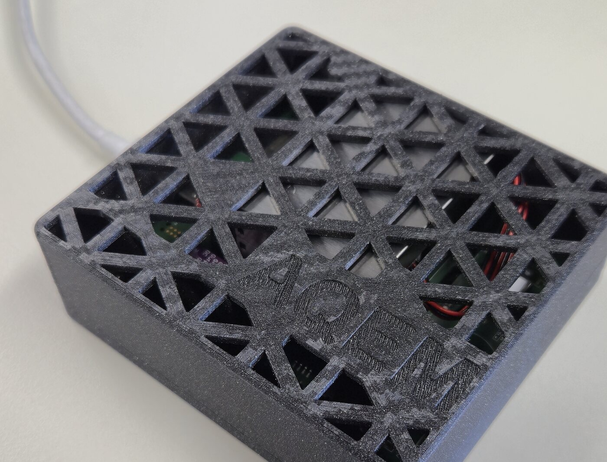
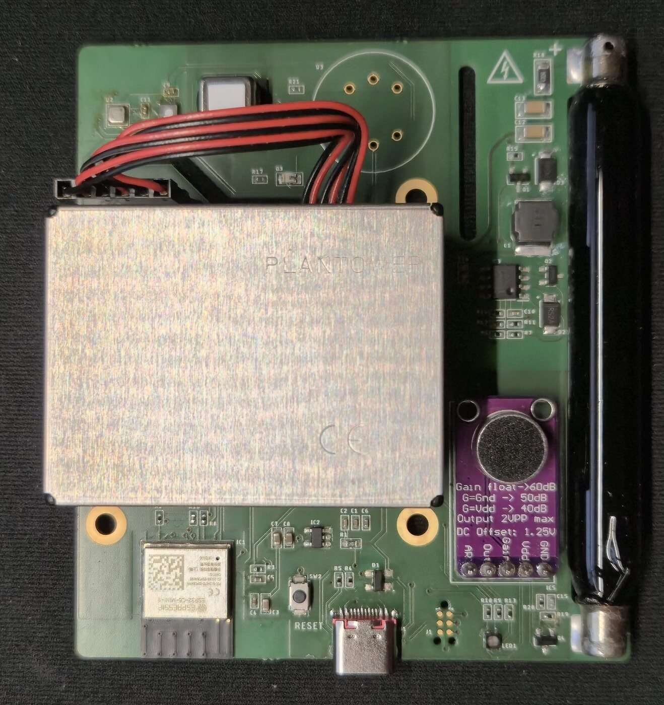
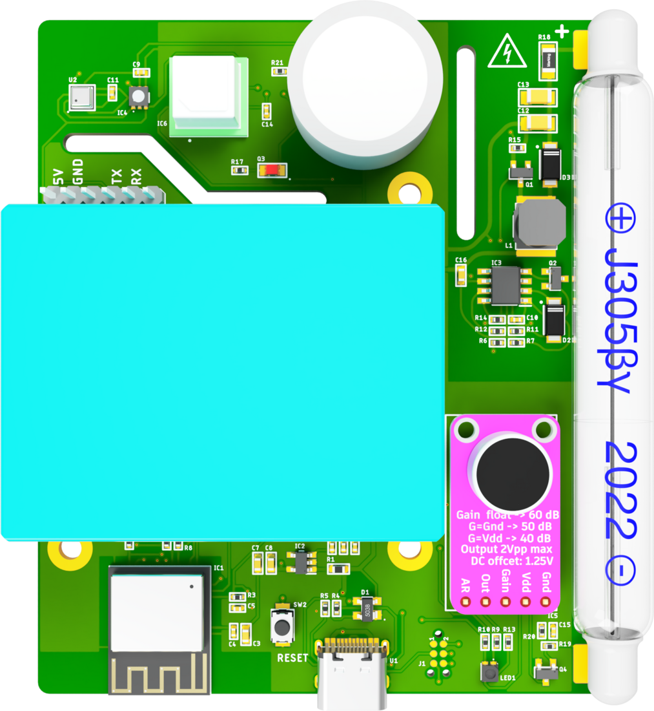
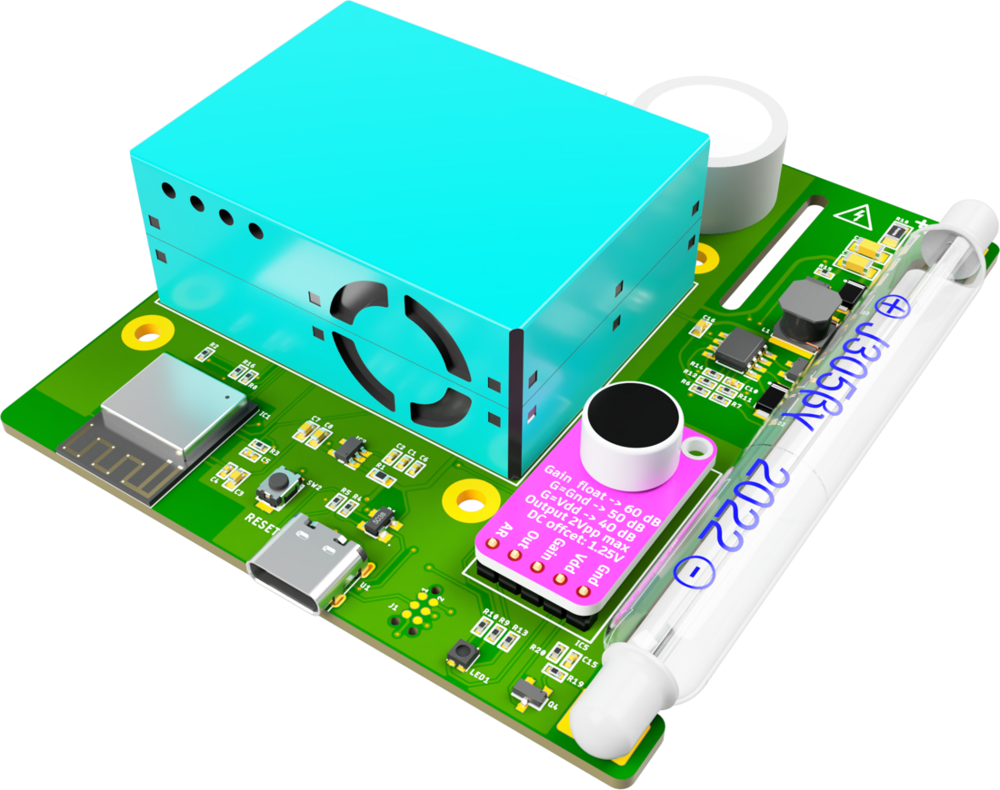
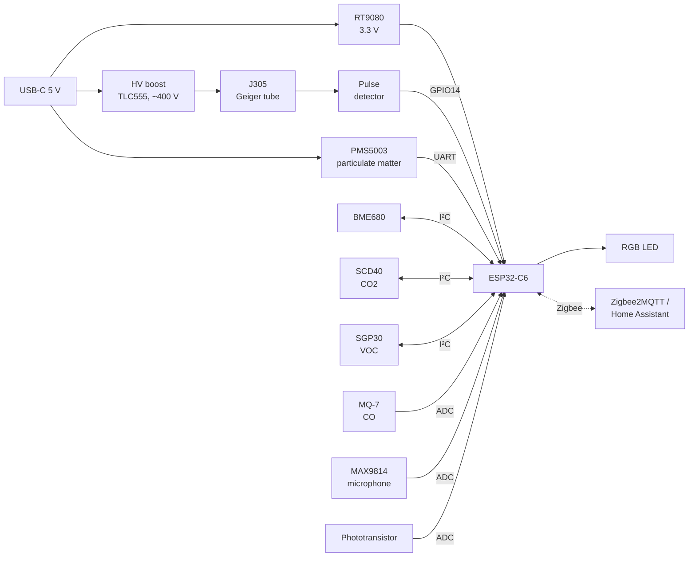
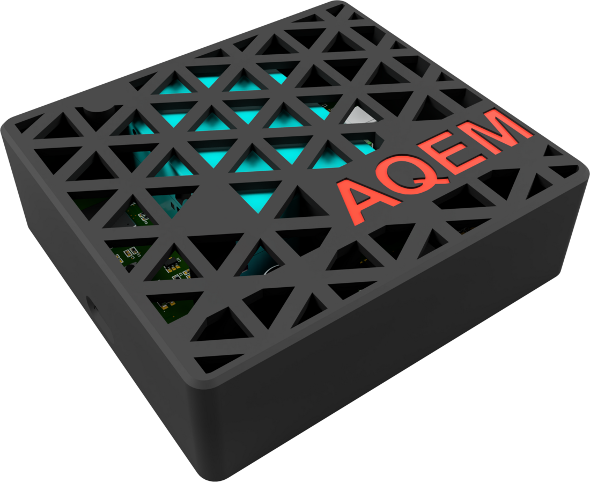
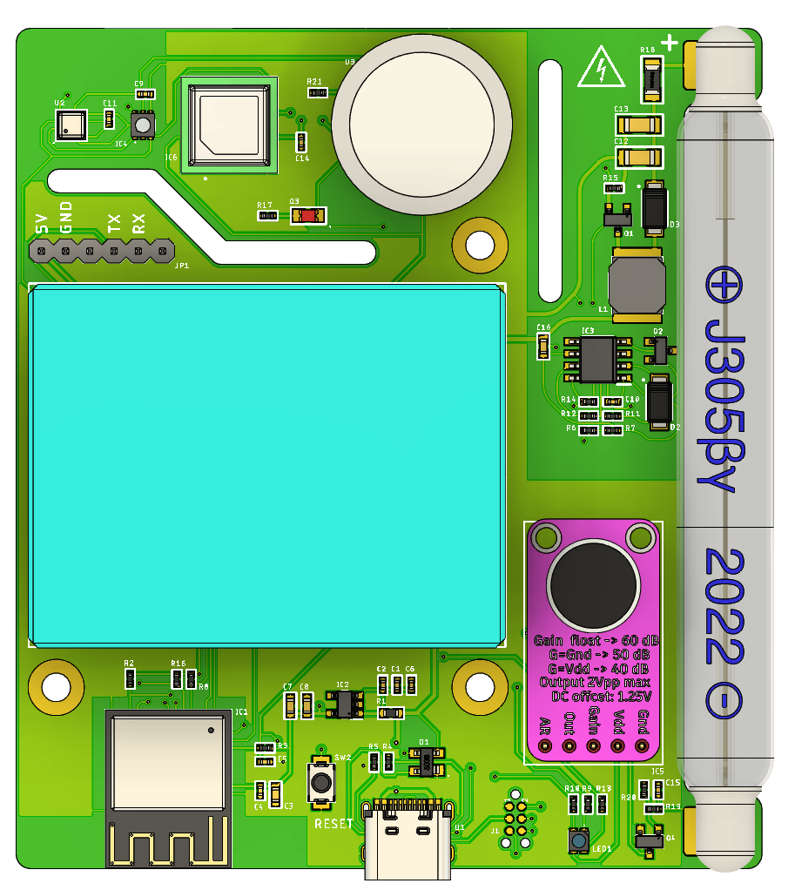
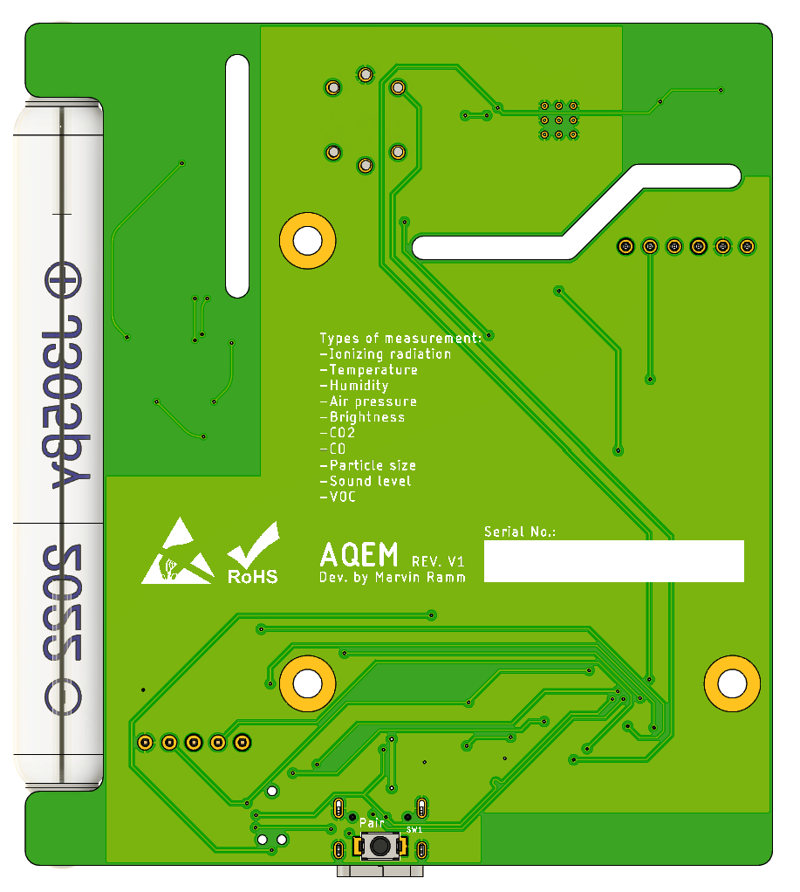

# AQEM – Air Quality Environment Module

**Zigbee sensor for the smart home that measures ten things on one board: ionizing radiation, temperature, humidity, air pressure, brightness, CO2, CO, particulate matter, sound level and VOC. It runs on USB-C and sends everything to Home Assistant through Zigbee2MQTT.**

  
  

I built the AQEM in 2025 as an all-in-one environment sensor for my home. Instead of a separate device for CO2, fine dust and radiation, one board with an ESP32-C6 carries all sensors and reports them over Zigbee. The case is 3D printed with an open lattice, so the air reaches the sensors freely.

## Features

| Measurement | Sensor | Unit |
|---|---|---|
| Ionizing radiation (gamma) | J305 Geiger-Müller tube, own 400 V converter | CPM, µSv/h |
| Temperature, humidity | BME680 + SCD40 (mean value) | °C, % RH |
| Air pressure | BME680 | hPa |
| CO2 | Sensirion SCD40 (photoacoustic NDIR) | ppm |
| VOC | Sensirion SGP30 | ppb TVOC |
| CO | MQ-7 | ppm (indicative) |
| Particulate matter | Plantower PMS5003 | PM1.0 / PM2.5 / PM10 in µg/m³ |
| Sound level | MAX9814 microphone with AGC | dB (estimate) |
| Brightness | Phototransistor | lx (approximate) |

- **ESP32-C6** as Zigbee 3.0 end device, ten endpoints, external converter for [Zigbee2MQTT](firmware/zigbee2mqtt/AQEM.js)
- **USB-C** 5 V supply and native USB for flashing and serial output
- **Geiger counter:** TLC555 boost converter for the tube voltage, transistor pulse detector, pulse-width filter in the firmware, LED flash per count
- **Thermal design:** milled slots between the warm parts and the climate sensors
- **RGB status LED** and a Pair button for joining or resetting the Zigbee network
- **3D-printed case** with lattice walls

  
  

## How it works

The firmware reads the fast sensors every second and the climate sensors and the PMS5003 every two seconds, averages each value over ten samples and sends everything to Zigbee every ten seconds. Each Geiger pulse is counted by interrupt; the dose rate is averaged over ten minutes.

## Case

  

## Firmware

AQEMOS V0.1.8, Arduino with ESP32 core 3.3. Build and flash instructions, the measurement details, the Zigbee endpoints and the Home Assistant setup are in [`firmware/README.md`](firmware/README.md). Precompiled binaries are attached to the [release](https://github.com/marvinramm/AQEM-Air-Quality-Environment-Module/releases).

## Hardware

> [!WARNING]
> The Geiger tube runs at about 400 V. Unplug USB before you touch the tube or the HV section.

| | |
|---|---|
| PCB | 2 layers, 78.3 × 88.1 mm |
| Schematic | [`hardware/aqem-v1/AQEM-V1_schematic.pdf`](hardware/aqem-v1/AQEM-V1_schematic.pdf) |
| BOM | [`hardware/aqem-v1/AQEM-V1_BOM.csv`](hardware/aqem-v1/AQEM-V1_BOM.csv), [interactive BOM](hardware/aqem-v1/AQEM-V1_ibom.html) |
| Design files | EAGLE / Fusion Electronics in [`hardware/aqem-v1/source`](hardware/aqem-v1/source) |
| Fabrication data | Gerber and ODB++ in the [release](https://github.com/marvinramm/AQEM-Air-Quality-Environment-Module/releases) |

Block description, pin assignment and lessons from the first build: [`hardware/README.md`](hardware/README.md).

  
  

## Accuracy

The AQEM is a hobby project, not a measuring instrument. CO2 (SCD40), particulate matter (PMS5003) and the climate values come from factory-calibrated sensors. The dose rate uses the standard J305 conversion factor. CO, sound level and brightness are not calibrated and are meant as trends.

## License

© 2025 Marvin Ramm. Private persons may build, use and develop the AQEM further, **with mandatory attribution**:

- Firmware (`firmware/`): [PolyForm Noncommercial 1.0.0](LICENSE)
- Hardware and documentation: [CC BY-NC 4.0](hardware/LICENSE)

Credit "AQEM by Marvin Ramm" with a link to this repository. **If you earn money with the AQEM or a design based on it, you need my agreement and I get a share** – contact marvin@ramm-eng.de. Details are in [LICENSING.md](LICENSING.md).
